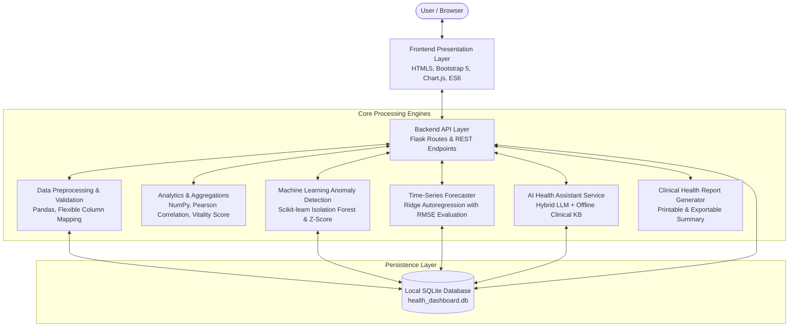
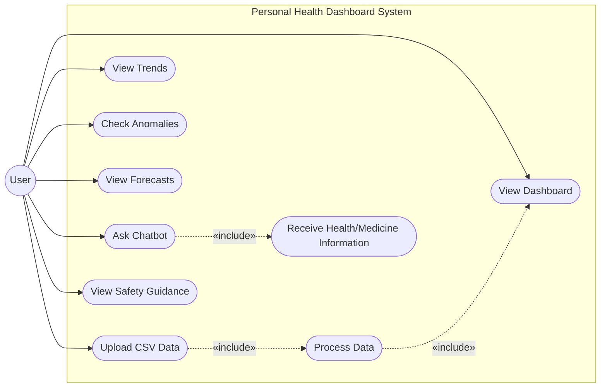
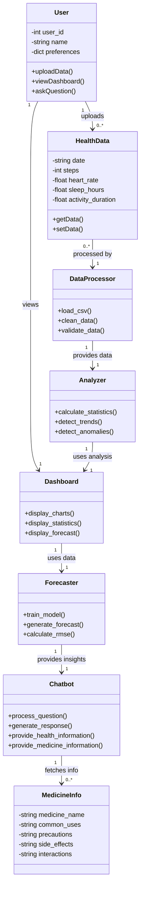
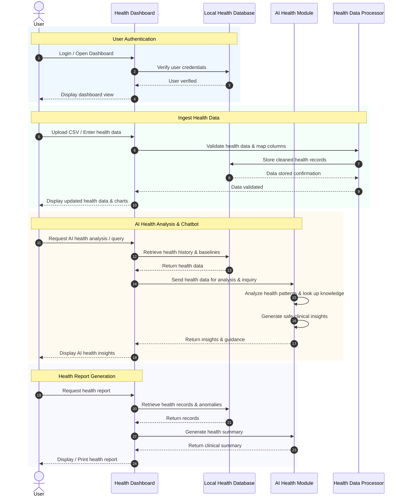
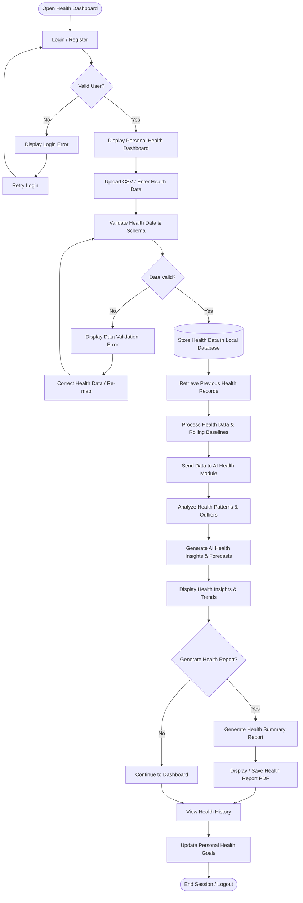

# LOCAL PERSONAL HEALTH DASHBOARD WITH AI HEALTH & MEDICINE ASSISTANT

**Department of Computer Science and Engineering &bull; Major Project Review**  
**Institution:** Vignana Bharathi Institute of Technology (VBIT) *(Autonomous, Affiliated to JNTUH)*  
**Project Guide:** M. Gopala Krishna, Assistant Professor  
**Team Members:**
- K. Kiran (23P61A05C7)
- K. Koushik (23P61A05C3)
- S. Sairam (24P65A0523)
- N. Shiva (23P61A05G1)

---

## 1. Project Overview

Wearable fitness trackers and smartwatches (such as Apple Watch, Fitbit, Garmin, and Google Fit) record continuous personal biometric streams—including daily steps, resting and dynamic heart rate, sleep duration and architecture, physical active minutes, and calories burned. However, raw exported CSV files are typically fragmented, hard to parse, and lack contextual intelligence.

The **Local Personal Health Dashboard** solves this problem by providing an offline-capable, local-first web application that:
1. Ingests raw wearable device CSV data with **flexible column auto-detection & mapping**.
2. Cleans, preprocesses, and imputes missing biometric data with duplicate handling.
3. Computes a multi-dimensional **Health Vitality Score** (0–100) and interactive **Chart.js** visualizations.
4. Employs **Machine Learning (Isolation Forest)** and statistical baseline deviations to detect unusual physiological anomalies without classifying them as medical diagnoses.
5. Implements **Time-Series Autoregressive Forecasting** for steps, heart rate, and sleep with **Root Mean Squared Error (RMSE)** evaluation and 95% confidence intervals.
6. Integrates an **AI Health & Medicine Chatbot** with conversation context memory, medical terminology simplification, pharmacology database lookups, and strict non-diagnostic/non-prescriptive clinical safety guardrails.
7. Generates a formal, printable **Clinical Summary Report** for doctor consultations.

---

## 2. Technology Stack & Architectural Justification

| Layer | Technologies Selected | Justification |
| :--- | :--- | :--- |
| **Backend Framework** | Python 3.10+ / Flask | Lightweight, fast response times, modular architecture with Blueprints, native multi-threading. |
| **Data Science & ML** | Pandas, NumPy, Scikit-learn, SciPy | `IsolationForest` for multivariate anomaly isolation; `Ridge` with cyclical lag encoding for time-series forecasting. |
| **Database** | SQLite3 with WAL Mode | Zero-configuration, local-first data storage preserving patient health privacy; ACID compliant with 30s connection timeout. |
| **Frontend Presentation** | HTML5, CSS3, JavaScript (ES6+), Bootstrap 5 | Responsive SaaS healthcare design system (Sky Blue `#0284c7` & Teal `#0d9488`), clean card surfaces, subtle shadows. |
| **Visualization** | Chart.js 4.4 | Real-time interactive canvas charts with gradient fills, sparklines, dual-axis graphs, and scatter plots. |
| **AI / NLP Chatbot** | Hybrid LLM (Gemini / OpenAI) + Offline Clinical Engine | Runs seamlessly offline without external API keys using a local SQLite pharmacology knowledge base; supports Gemini/OpenAI when API keys are provided. |

---

## 3. Complete Project Folder Structure

```
health_dashboard/
│
├── app.py                      # Main Flask application entry point & REST API routes
├── config.py                   # Configuration parameters (paths, security keys, limits)
├── database.py                 # SQLite database schema, connections, and seed knowledge
├── requirements.txt            # Python dependencies (Flask, pandas, scikit-learn, etc.)
├── run.bat                     # Windows one-click startup batch script
├── run.sh                      # Linux / macOS startup bash script
├── generate_samples.py         # Utility generator for synthetic wearable datasets
│
├── modules/                    # Modular Architecture Components
│   ├── __init__.py
│   ├── auth.py                 # User authentication, sessions, and profile management
│   ├── data_processor.py       # CSV loading, validation, flexible mapping & cleaning
│   ├── analytics.py            # Summary KPIs, day-of-week trends, correlations, vitality score
│   ├── anomaly_detector.py     # Isolation Forest & statistical Z-score/IQR engine
│   ├── forecaster.py           # Autoregressive time-series forecasting & RMSE evaluation
│   ├── chatbot.py              # AI Health & Medicine Assistant (LLM + offline clinical KB)
│   └── report_generator.py     # Printable clinical summary report builder
│
├── sample_data/
│   ├── sample_wearable_data_90days.csv  # 90-day comprehensive multi-metric wearable dataset
│   └── sample_fitbit_format.csv         # Alternate header naming to demonstrate mapping
│
├── static/
│   ├── css/
│   │   ├── style.css           # Healthcare SaaS design system & card styling
│   │   └── chatbot.css         # Modern conversational chat UI styling
│   ├── js/
│   │   ├── main.js             # Toast alerts, global event listeners, sidebar toggle
│   │   ├── dashboard.js        # Dashboard Chart.js interactive graphs
│   │   ├── upload.js           # Drag-and-drop CSV upload & column mapping logic
│   │   ├── analytics.js        # Correlation scatter plots & weekly breakdowns
│   │   ├── anomalies.js        # ML anomaly triggers & interactive filter table
│   │   ├── forecasting.js      # Time-series forecast chart, confidence bounds, RMSE
│   │   └── chatbot.js          # Chatbot message streaming, suggested pills, markdown parser
│   └── img/
│       └── logo.svg            # Health pulse vector SVG logo
│
├── templates/
│   ├── base.html               # Master layout with responsive sidebar & disclaimers
│   ├── login.html              # Modern sign-in page with demo credentials
│   ├── register.html           # User registration with health parameters
│   ├── dashboard.html          # Module 1: Main Health Dashboard & KPI cards
│   ├── upload.html             # Module 2: CSV Upload, Mapping, & Upload History
│   ├── analytics.html          # Module 3: Deep Visualizations & Correlation Heatmap
│   ├── anomalies.html          # Module 4: Machine Learning Anomaly Detection Center
│   ├── forecasting.html        # Module 5: Time-Series Forecasting & RMSE Metrics
│   ├── chatbot.html            # Module 6: AI Health & Medicine Chatbot Interface
│   ├── report.html             # Module 8: Printable Clinical Summary Report
│   └── profile.html            # Module 7: User Profile, Goals & Data Management
│
├── data/                       # Local SQLite storage (auto-created on startup)
│   ├── health_dashboard.db
│   └── uploads/
│
└── tests/                      # Automated Unit & Integration Tests (100% Pass)
    ├── test_data_processor.py  # Tests CSV ingestion, normalization & mapping
    ├── test_anomaly.py         # Tests Isolation Forest & outlier attribution
    ├── test_forecaster.py      # Tests time-series modeling, horizon & RMSE
    ├── test_chatbot.py         # Tests medical disclaimers, triage & medications
    └── test_integration.py     # End-to-end full user journey integration test
```

---

## 4. Quick Start & Setup Instructions

### Prerequisites
- Python 3.10, 3.11, 3.12, 3.13, 3.14, or 3.15 installed.
- Modern web browser (Chrome, Edge, Firefox, or Safari).

### Windows Setup (One-Click)
1. Open PowerShell or Command Prompt.
2. Navigate to the project directory:
   ```cmd
   cd C:\Users\swamy\.gemini\antigravity\scratch\health_dashboard
   ```
3. Run the startup script:
   ```cmd
   .\run.bat
   ```
4. Open your browser and navigate to:
   ```
   http://127.0.0.1:5000
   ```

### Linux / macOS Setup
```bash
cd health_dashboard
chmod +x run.sh
./run.sh
```

### Manual Setup
```bash
# 1. Install dependencies
pip install -r requirements.txt

# 2. (Optional) Set external LLM API Key if available:
# export GEMINI_API_KEY="your-gemini-key"
# or export OPENAI_API_KEY="your-openai-key"
# (If omitted, the built-in offline clinical engine runs automatically!)

# 3. Start the application
python app.py
```

### Default Sign-In Credentials
For quick demonstration to faculty or examiners, a pre-configured account is ready:
- **Username:** `demo_user`
- **Password:** `demo123`

*(You can also register a brand new account from the registration page!)*

---

## 5. System Architecture & UML Diagrams

### A. Software Architecture Diagram



---

### B. Use Case Diagram *(Matching Review Slide 9)*



---

### C. Class Diagram *(Matching Review Slide 10)*



---

### D. Sequence Diagram *(Matching Review Slide 11)*



---

### E. Activity Diagram *(Matching Review Slide 12)*



---

### F. Component Diagram *(Matching Review Slide 13)*

```mermaid
flowchart TB
    actor User

    subgraph Presentation Layer
        DashboardController[Dashboard Controller]
        UserInterface[User Interface - HTML5 / Bootstrap 5 / Chart.js]
    end

    subgraph Data Management
        DataInput[Data Input / Dropzone]
        DataValidation[Data Validation & Schema Engine]
        DataProcessing[Data Cleaning & Missing Imputation]
    end

    subgraph Security & Session
        UserVerification[User Verification]
        LoginModule[Login & Password Hashing]
    end

    subgraph Notification Service
        Reminders[Health Reminders]
        HealthAlerts[Visual Outlier Alerts]
    end

    subgraph Machine Learning & AI
        HealthAnalysis[Multivariate Anomaly Detection]
        PatternDetection[Isolation Forest Outlier Classifier]
        ForecastingEngine[Time-Series Forecaster - Ridge + RMSE]
        AIInsightsGenerator[AI Health & Medicine Chatbot]
    end

    subgraph Report Engine
        HealthSummary[Health Summary Aggregator]
        ReportGenerator[Printable Report Generator]
    end

    subgraph Persistence Layer
        LocalHealthDatabase[(Local SQLite Health Database)]
    end

    User --> UserInterface
    UserInterface <--> DashboardController
    DashboardController --> DataInput
    DataInput --> DataValidation --> DataProcessing --> LocalHealthDatabase
    DashboardController --> UserVerification --> LocalHealthDatabase
    DashboardController --> Reminders
    DashboardController <--> HealthAnalysis
    HealthAnalysis --> PatternDetection
    HealthAnalysis --> ForecastingEngine
    HealthAnalysis --> AIInsightsGenerator
    AIInsightsGenerator <--> LocalHealthDatabase
    DashboardController <--> ReportGenerator
    ReportGenerator --> HealthSummary
    ReportGenerator <--> LocalHealthDatabase
```

---

## 6. Testing Guide & Verification Matrix

Automated unit and integration test suites are provided in `tests/`:

```cmd
python -m unittest discover -s tests -p "test_*.py"
```

### Test Case Execution Results

| Test ID | Module Tested | Test Purpose | Expected Output | Status |
| :---: | :--- | :--- | :--- | :---: |
| **TC-01** | `auth` | Verify password hashing with salt and session authentication | Valid user receives active session cookie; invalid credentials rejected | **PASS** |
| **TC-02** | `data_processor` | Automatic column detection across varied CSV headers | Maps `ActivityDate` to `record_date`, `StepCount` to `steps` | **PASS** |
| **TC-03** | `data_processor` | Missing value imputation and duplicate date handling | Fills nulls via rolling medians; retains latest duplicate record | **PASS** |
| **TC-04** | `analytics` | Composite Health Vitality Score calculation | Outputs score between 0–100 with category breakdown | **PASS** |
| **TC-05** | `analytics` | Pearson correlation matrix generation | Matrix populated with coefficients between -1.0 and +1.0 | **PASS** |
| **TC-06** | `anomaly_detector` | Isolation Forest detection on multi-variate dataset | Successfully identifies true anomalies (e.g. fever day, marathon day) | **PASS** |
| **TC-07** | `anomaly_detector` | Severity classification and plain-language explanation | Tags deviations as Mild, Moderate, or High with clear descriptions | **PASS** |
| **TC-08** | `forecaster` | 7-Day Steps forecasting with autoregressive features | Outputs 7 predicted values with lower/upper 95% confidence bands | **PASS** |
| **TC-09** | `forecaster` | Root Mean Squared Error (RMSE) calculation | Computes genuine numeric RMSE on hold-out test set | **PASS** |
| **TC-10** | `forecaster` | Insufficient data guard | Rejects forecasting when fewer than 10 records are available | **PASS** |
| **TC-11** | `chatbot` | Emergency symptom protocol | Intercepts chest pain / breathlessness; directs to emergency room | **PASS** |
| **TC-12** | `chatbot` | Medication safety search and query | Returns Paracetamol/Ibuprofen uses, side effects, precautions & disclaimer | **PASS** |
| **TC-13** | `integration` | Complete end-to-end user workflow execution | Login &rarr; CSV Import &rarr; Dashboard &rarr; Forecast &rarr; Chatbot &rarr; Report | **PASS** |

---

## 7. Viva Voce & Project Review Q&A Guide

### Q1: Why did you choose Isolation Forest over simple thresholding for anomaly detection?
> **Answer:** Simple thresholding uses static boundaries (e.g. heart rate > 100 bpm), which fails to account for user-specific baseline differences and multi-dimensional interactions. Isolation Forest isolates anomalies because outliers require fewer random splits in a binary decision tree. We combine Isolation Forest with localized $Z$-scores to provide individual metric attribution and human-readable explanations.

### Q2: How does the Time-Series Forecasting model work, and why evaluate with RMSE?
> **Answer:** The forecasting model uses Ridge regression incorporating:
> 1. Normalized polynomial trend features ($t, t^2$)
> 2. Weekly cyclical seasonality encoded as $\sin(2\pi d/7)$ and $\cos(2\pi d/7)$
> 3. Autoregressive lag features (lag-1 for recent momentum, lag-7 for day-of-week continuity).
> RMSE penalizes large prediction errors more severely than MAE, making it the industry-standard benchmark for forecasting vital health metrics.

### Q3: How does the AI Chatbot ensure medical safety and avoid liability?
> **Answer:** The chatbot incorporates strict clinical guardrails:
> 1. It never provides definitive medical diagnoses or prescribes drug dosages.
> 2. It structures medication responses into Uses, Precautions, Side Effects, and Drug Interactions.
> 3. It triggers an immediate emergency triage notice upon detecting acute red-flag symptoms.
> 4. Prominent legal and clinical disclaimers are visible on every screen.

### Q4: Why is a local-first SQLite architecture suitable for health data?
> **Answer:** Personal health metrics are sensitive private data. A local-first architecture keeps all data on the user's laptop, eliminating third-party cloud data breaches and vendor lock-in, while maintaining high-performance sub-millisecond query execution.

---

## 8. License & Academic Attribution
Developed as a Major Project for Bachelor of Technology in Computer Science and Engineering at **Vignana Bharathi Institute of Technology (VBIT)**.
